<!-- Header banner -->

---

## Who Am I

  

 

  
  
  
  
  
  

## What I do

| Focus | What it looks like |
| --- | --- |
| 🧪 **Release testing** | Pre-release passes on plugin builds: upgrade from the previous version, free and pro together, responsive layouts, accessibility, performance. Ends in a clear ship / no-ship call. |
| 🔎 **Manual and exploratory testing** | Hands-on testing in real browsers: every setting, edge cases, wrong input, refresh mid-save, small screens. |
| 🎭 **Test automation** | Playwright + TypeScript regression suites that run in GitHub Actions and block a release when a core flow breaks. |
| 👥 **Permissions and input** | The same feature tried as admin, editor and subscriber, plus invalid and hostile input in every field. |
| 🤖 **AI-assisted QA** | I turn my QA process into reusable [Claude Code](https://claude.com/claude-code) skills, so a thorough pass is a workflow and not a mood. |
| 📸 **Bug reports devs can act on** | Cold-start repro steps, expected vs actual, exact values, console errors and an annotated screenshot for every finding. |

## How I test

- I test like a real user first, then the awkward paths: wrong input, back button, refresh mid-save, small screens.
- A bug is real only after I **reproduce it twice** and **ask what would make it intentional**.
- I check the **previous release** too, so a new regression is not confused with an old issue.
- A report is not done until a developer can reproduce it cold: build, steps, expected vs actual, screenshot.
- After a fix, I verify it in the browser and re-check the area around it.
- The happy path passing is where testing starts, not where it ends.

## Experience

**Jr. Software Test Engineer** · Startise · Dhaka, Bangladesh

- Responsible QA for five WordPress products at the same time: [Essential Blocks](https://essential-blocks.com), [Templately](https://templately.com), [BetterLinks](https://betterlinks.io), [NotificationX](https://notificationx.com) and [SchedulePress](https://schedulepress.com), switching between their releases and test plans.
- Test plugin releases end to end: upgrades from the previous version, free and pro together, responsive layouts, accessibility and performance.
- Write bug reports developers can act on: cold-start steps, expected vs actual, exact values, console errors and annotated screenshots.
- Verify developer fixes in the browser and re-check the surrounding area for regressions.
- Build Playwright + TypeScript regression suites that run in GitHub Actions.
- Build Claude Code QA skills that turn a thorough test pass into a repeatable workflow.

**Software QA Engineer Intern** · Fiftytwo Digital Ltd. · Dhaka, Bangladesh · Sep 2025 – Mar 2026

- Manual testing of enterprise POS web and mobile apps: payments, refunds and store configuration.
- Functional, regression and sanity test cases from requirements; defects tracked in JIRA.
- Playwright E2E tests for production projects used by European customers, including Salling Group (Denmark).

## Featured projects

<table>
  <tr>
    <td width="50%" align="center">
      
    </td>
    <td width="50%" align="center">
      
    </td>
  </tr>
  <tr>
    <td width="50%" align="center">
      
    </td>
    <td width="50%" align="center">
      
    </td>
  </tr>
</table>

Also: [wp-eb-test-skill](https://github.com/siam14441/wp-eb-test-skill) — ticket-scoped QA skill that builds its checklist from the diff.

## Toolbox

 

- **Testing:** Playwright · ARIA snapshots · GitHub Actions CI · cross-browser and responsive checks · accessibility audits
- **Method:** regression testing · upgrade-path testing · exploratory testing · bug reporting
- **Also:** Claude Code skills · Markdown reports · Git

## Let's connect

Found a bug in my README? Open an issue. I'll reproduce it twice first. 😉

